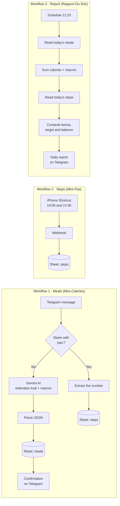

# 🍽️ Telegram Calorie Tracker (n8n + AI)

**Log your meals by sending a simple message to a Telegram bot. An AI estimates the calories and macros instantly, and every evening you get a daily report that adjusts your calorie target based on how many steps you walked.**

Built with [n8n](https://n8n.io), Google Gemini, Google Sheets, Telegram and an iPhone Shortcut. No code required to run it, and no paid service required to start.

---

## 😩 The problem

I had been counting my calories with a popular tracking app for about 80 days, and I kept running into the same friction:

- **Logging takes time.** Searching for every single food, picking the right entry and adjusting the portion, every day, gets tedious.
- **The food database is incomplete.** Many foods I eat simply don't exist in the app, so I had to look up the calories somewhere else, then enter them manually.
- **I skipped days.** Because of the effort, I would sometimes go 2 or 3 days without logging anything, which defeats the purpose of tracking.
- **No API.** The app has no public API, so I couldn't automate it.

The real obstacle wasn't motivation, it was **friction**.

## 💡 The solution

Replace the search-and-select workflow with **plain language**.

Instead of opening an app, I send a message like:

```
2 eggs, a slice of bread and a milk coffee
```

and a few seconds later, the bot answers with the estimate and the meal is stored in a spreadsheet. The AI handles foods that no database lists, and I never leave my chat app.

> ⚠️ **Calories are estimates.** The AI assumes standard portions when none are given. This is good enough for daily awareness and trends, but it is not medical or nutritional advice.

---

## ✨ Features

- **Natural-language meal logging** through Telegram (any language the AI understands).
- **AI estimation** of calories, protein, carbs and fat for each meal.
- **Automatic storage** in a Google Sheet, one row per meal.
- **Automatic step tracking:** an iPhone Shortcut reads your steps from Apple Health and sends them to n8n twice a day.
- **Dynamic daily target:** walking earns you extra calories (see the rule below).
- **Daily report on Telegram** with calories eaten, steps, bonus, target, and what's left or by how much you went over.
- **Manual fallback:** send `steps 8000` (or `pas 8000`, see note below) to the bot to set your steps by hand if the phone missed an update.

## 🧮 The calorie rule

```
bonus   = floor(steps / 5000) × 100 kcal
target  = 2000 kcal + bonus
balance = target − calories eaten
```

| Steps | Bonus | Daily target |
|------:|------:|-------------:|
| 4,000 | 0 kcal | 2,000 kcal |
| 5,000 | +100 kcal | 2,100 kcal |
| 9,999 | +100 kcal | 2,100 kcal |
| 10,000 | +200 kcal | 2,200 kcal |

If the balance is positive, the report says how many calories are left. If it is negative, it says by how many calories you went over. The base target (2000) and the step rule can be changed in the **Code** node of the report workflow.

---

## 🏗️ How it works

The project is made of **three n8n workflows** that share one Google Sheet.



### Workflow 1 — `Mes-Calories` (meal logging)

1. **Telegram Trigger** receives every message sent to the bot.
2. An **If** node routes the message: text starting with `pas` is treated as a manual step count, anything else is a meal.
3. For meals, a **Basic LLM Chain** with **Google Gemini** receives a system prompt that forces a strict JSON answer: `{"repas", "calories", "proteines", "glucides", "lipides"}`.
4. An **Edit Fields** node parses the JSON into real typed fields and adds today's date.
5. **Google Sheets** appends the row, and the bot replies with a confirmation such as `Ajouté : 2 œufs et du pain → 280 kcal`.

### Workflow 2 — `Mes-Pas` (automatic step sync)

1. An **iPhone Shortcut** reads today's steps from Apple Health and sends them as JSON to an n8n **Webhook**.
2. The webhook payload is cleaned and written to the `pas` sheet with **Append or Update Row**, matching on the date. This guarantees **one row per day**: the 21:00 value simply replaces the 14:00 one.

### Workflow 3 — `Rapport-Du-Soir` (daily report)

1. A **Schedule Trigger** runs every day at 21:10 (after the last step sync).
2. It reads today's meals, **Summarize** adds up calories and macros, then a second Sheets node reads today's steps.
3. A **Code** node applies the calorie rule and the bot sends the formatted report.

---

## 🧰 Tech stack

| Role | Tool |
|---|---|
| Automation engine | [n8n](https://n8n.io) (cloud or self-hosted) |
| AI model | Google Gemini (free tier is enough) |
| Chat interface | Telegram Bot API |
| Database | Google Sheets |
| Step data | Apple Health + iOS Shortcuts |

---

## 📁 Repository structure

```
.
├── README.md
├── workflows/
│   ├── Mes-Calories.json        # Meal logging (Telegram → AI → Sheet)
│   ├── Mes-Pas.json             # Step sync (iPhone → Webhook → Sheet)
│   └── Rapport-Du-Soir.json     # Daily report
└── screenshots/                        # Screenshots
```

> The workflow and node names are in French because I built the project in French. The logic is language-independent.

---

## 🚀 Setup

### 1. Create the Telegram bot
1. In Telegram, open **@BotFather** and send `/newbot`.
2. Choose a name and a username ending with `bot`.
3. Save the **token** it gives you.

### 2. Create the Google Sheet
Create a spreadsheet with **two tabs**:

**Tab 1 — meals** (first row):

| date | repas | calories | protéines | glucides | lipides |
|---|---|---|---|---|---|

**Tab 2 — `pas`** (first row):

| date | pas |
|---|---|

Column names must match exactly (accents included), because n8n maps fields to columns by name.

### 3. Get a Gemini API key
Create a key in [Google AI Studio](https://aistudio.google.com). You can swap Gemini for another model (e.g. Claude or OpenAI) by replacing the chat-model sub-node.

### 4. Set up n8n
1. Create an account on n8n cloud, or self-host it. The cloud version is the easiest, because Telegram needs a public URL to reach your instance.
2. Create three credentials: **Telegram** (your bot token), **Google Sheets** (Google sign-in) and **Google Gemini** (your API key).

### 5. Import the workflows
For each file in `workflows/`: in n8n, open **Workflows → Import from file**.

Then replace the placeholders:

| Placeholder | Where | What to put |
|---|---|---|
| `VOTRE_CREDENTIAL_ID` | credentials of each node | Re-select your own credentials in each node |
| `VOTRE_ID_GOOGLE_SHEET` | every Google Sheets node | Re-select **your** spreadsheet and tabs in the node |
| `VOTRE_CHAT_ID` | Telegram node in `Rapport-Du-Soir` | Your Telegram chat ID (see below) |
| `VOTRE_CHEMIN_SECRET` | Webhook node in `Mes-Pas` | A long random string, e.g. `steps-x7k2q9mw4p` |

> **Finding your chat ID:** publish workflow 1, send any message to your bot, then open the execution in the **Executions** tab and read `message → chat → id` in the Telegram Trigger output.

Also set the workflow **timezone** (Workflow → Settings → Timezone), then **Publish** all three workflows.

### 6. Create the iPhone Shortcut
In the **Shortcuts** app, create a shortcut with these actions:

1. **Find Health Samples** — Type: `Steps`, Start Date: `is today` (turn the *Limit* off).
2. **Calculate Statistics** — `Sum`.
3. **Get Contents of URL** — URL: your **Production URL** (`.../webhook/<your-secret-path>`), Method: `POST`, Request Body: `JSON`, with a number field `pas` set to the **Statistics** variable.

Then go to **Automation → Time of Day** and create two automations (`14:00` and `21:00`) that **Run Immediately** your shortcut.

> The iPhone must be on at those times, and unlocked at least once since its last restart for Health data to be readable.

### 7. Test it
- Send `2 eggs and a slice of toast` to your bot → you get a confirmation and a new row in the sheet.
- Run the shortcut manually → the `pas` tab updates with today's steps.
- Run workflow 3 manually → you receive the daily report.

> **Note on the `pas` keyword:** the manual step override is triggered by a message starting with `pas` (French for "steps"). Change the value in the **If** node of workflow 1 and the regex in **Edit Fields1** if you prefer another word.

---

## 🔒 Security notes

- **Never commit** your Telegram token, API keys, chat ID, sheet ID or webhook URL. The exported workflows in this repo have these values replaced by placeholders, and n8n never exports credential secrets.
- The webhook is protected only by its **secret path**. For stronger protection, enable **Header Auth** on the webhook node and add the header in the Shortcut.
- Anyone who finds your bot's username can message it. To restrict it to yourself, add a check on `message.chat.id` right after the Telegram Trigger.

## ⚠️ Limitations

- Calorie and macro values are **AI estimates**, and accuracy depends on how precisely you describe the meal.
- If the AI ever returns invalid JSON, the meal workflow fails for that message (visible in **Executions**).
- Step syncing relies on the iPhone running the automations at the scheduled times.
- It is a personal single-user setup, not a multi-user product.

## 🗺️ Ideas for improvement

- Weekly summary every Sunday (average calories, total steps, trend).
- An extra mid-afternoon report after the 14:00 step sync.
- Photo-based logging by sending a picture of the plate to a vision model.
- Retry and error-handling branch when the AI output can't be parsed.
- A `/undo` command to remove the last logged meal.

## 📄 License

MIT — feel free to reuse and adapt.

---

*Built as a first n8n project, learned by building. If it helps you, a ⭐ is appreciated.*
